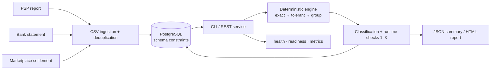

[](README.tr.md)

# Case study: ReconPilot, a deterministic payment reconciliation engine

> ### Claim: about 49,000 transactions (`-n 50000`) · 3 sources · 7 injected discrepancy types: 7/7 detected, 0 false matches, 0 intended pairs/groups missed
>
> | | |
> |---|---|
> | Repository | [Public source, tests and benchmark](https://github.com/hilberspace-dev/reconpilot) |
> | Benchmark | Seeded and deterministic: `go run ./cmd/benchmark` reproduces the dataset and checks on any machine |
> | "0 false matches" | Every produced match is validated member-by-member against generator ground truth; the benchmark reports 0 false matches |
> | CI | Every push runs PostgreSQL integration tests, architecture/vulnerability checks, a seeded Compose endpoint smoke test and the benchmark |
> | Service surface | Versioned REST endpoint, HTML report, health/readiness, Prometheus metrics and one-command seeded Docker Compose stack |
> | Stack | Go 1.26 + PostgreSQL; one module; the service is one static binary (`recon`), and a second small binary (`verify`) serves the benchmark panel; stdlib-first (only runtime dependency: `pgx`) |
>
> The benchmark data is synthetic. The discrepancies are injected, and the generator is in the
> repository. It tests the engine's deterministic behaviour; it has never run on customer data. The
> synthetic data is also built so that the ground truth stays unambiguous. The open rows of an
> injected discrepancy never share a tolerant window with an open row of another injected order of
> the same seller (clean orders are matched exactly first). A seller paid in groups gets at most two
> payouts, and the second group is shifted 35 days later, so the two 14-day payout windows never
> overlap (the gap between the two payout dates is 16 to 54 days). But real books can contain
> ambiguous same-seller rows that the tolerant or group matcher would pair.

> For non-technical readers: an online store gets paid through several channels at once (the
> card-payment provider, marketplaces and its bank account), and each one reports the "same" money
> differently. Someone in finance has to make the three stories agree, usually by hand in Excel.
> Mistakes there are silent and expensive. ReconPilot does it automatically, for tens of
> thousands of transactions in seconds, and puts every mismatch into a named category. One command
> replays a benchmark of about 49,000 transactions. It checks every decision against a known answer
> key and finds zero wrong pairings. And if an input record is neither matched nor classified, or a
> transaction-level discrepancy delta violates its type's money rules, it refuses to return a result.

- Domain: e-commerce payment operations; PSP reports vs. bank statements vs. marketplace settlements
- Outcome: a reconciliation service whose correctness rules are enforced by runtime and database
  invariants and exercised by property-based tests. REST, HTML and metrics expose it; a seeded
  benchmark and a Docker Compose demo reproduce it.

## The problem

A mid-size e-commerce operation collects money through several pipes at once: card payments through a
PSP, marketplace settlements paid out days later as lump sums (gross minus commission, dozens of
orders per payout), and a bank statement that records whatever actually moved. Finance teams close
the gap by hand in Excel. Manual matching fails silently, in two ways. The first is a false match:
records whose amounts happen to coincide get glued together, and the books look closed but are
wrong. The second is lost residue, the records that fall out of every filter and get written off
without anyone noticing. Neither leaves a trace.

## System view



## The engineering

- Matching runs in three deterministic, explainable stages. Exact comes first (reference + amount +
  direction, ±3-day window), then tolerant (±0.5%, bank lines only), then bounded many-to-one group
  matching for payouts (payout = Σ orders − commission). The subset search is bounded before it
  starts: counterparty + 14-day window, ≤20 candidates. If that overflows, the engine does not
  guess; the result is an explicit `unknown`.
- Three runtime invariants fail hard. Every input transaction is matched or classified; no
  transaction appears in two match groups; and every transaction-level discrepancy delta obeys its
  type's money semantics. There is a fourth guarantee at ingestion: re-ingesting the same file adds
  no transactions. PostgreSQL `UNIQUE(dedup_key)` enforces that, and a real-database integration
  test covers it. The schema also backs the no-double-match rule and rejects ownerless discrepancy
  rows.
- Money is `int64` minor units end to end. There are no floats or epsilons, and a one-kuruş
  difference stays exactly representable through matching, classification and reporting.
- `go-arch-lint` enforces the one-way flow `ingestion → matching → classification → reporting` in
  CI, and a change that breaks the architecture fails the build.

## Operational surface

`POST /api/v1/reconciliation-runs` loads the stored transactions and invokes the same pure engine as
the CLI. Then it checks the three runtime invariants and persists the result atomically. `/healthz`
reports process liveness; `/readyz` reports readiness, with PostgreSQL taken into account.
`/metrics` exposes fixed-cardinality Prometheus metrics, and `/report` serves the existing HTML
report. Timeouts are bounded and shutdown is graceful.

`docker compose up --build -d` builds the non-root static image, starts PostgreSQL, loads the golden
dataset (loading it again adds no transactions) and runs the first reconciliation. The API then
reports readiness on `/readyz`. So the benchmarked algorithm is also an operable service, without a
second stack.

## Verification

The verification panel (`go run ./cmd/verify`) renders the scored run for seed 1. The full page,
with its paragraph on the limits of the run, is `docs/verification-panel.png` in the repository:


Property-based tests exercise the invariants on 100 randomized books per run, with shrinking.
Integration tests run against a real PostgreSQL via testcontainers. There is no mock in between. The
benchmark generates about 49,000 transactions (`-n 50000`) and injects seven discrepancy types at
known positions. Then it checks that each injected record got its type and that the engine produced
no record the book does not account for. It also checks every produced match against the
generator's intended pairing:

```
reconpilot benchmark: n=49003 seed=1
elapsed: 906.7748ms

type           injected   detected    emitted   expected
commission          193        193       2036       2036  ok
refund              386        386        386        386  ok
partial             193        193        386        386  ok
timing              193        193        386        386  ok
duplicate           193        193        193        193  ok
missing             193        193        193        193  ok
unknown             193        193        193        193  ok
(detected: injected records that got their type. expected: the injected records, a delta-0
 record for each commission, partial and timing counterpart, and 1650 group fee records)

clean books: pairs=17706 groups=1650, matches produced: 20128
false matches: 0, intended pairs/groups not fully matched: 0
runtime invariants: 3/3 PASSED (checked inside engine.Run)

RESULT: PASS, 7/7 injected types detected, 0 false matches, 0 intended pairs/groups missed
```

Any false match makes it exit non-zero. So does an intended pair or group that is not matched whole,
an injected record that got another type, or a record nothing accounts for. CI runs it on every
push, and the benchmark step of the
[latest run on `main`](https://github.com/hilberspace-dev/reconpilot/actions?query=branch%3Amain)
shows the same PASS line on GitHub's own runner. The benchmark also passes for every seed from 1 to
100, at the default size (`-n 50000`) and at `-n 20000` (a shell loop over `-seed` checks that).
And the repository opens in GitHub Codespaces with the benchmark running, so the claim can be
checked without a local setup.

The main design decisions each have an ADR in the repository: integer money, single-stack
rationale, the bounded group search, schema-level invariants, and the HTTP/observability boundary.

`Go` `PostgreSQL` `REST` `Prometheus` `Docker Compose` `pgx` `property-based testing`
`testcontainers` `CI` `invariant-driven design`
