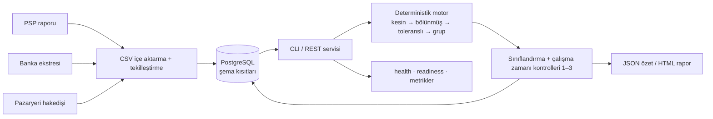

[](README.md)

# Vaka çalışması: ReconPilot, deterministik ödeme mutabakat motoru

> ### İddia: yaklaşık 50 bin işlem (`-n 50000`) · 3 kaynak · enjekte edilmiş 8 uyuşmazlık tipi: 8/8 tespit, 0 yanlış eşleşme, amaçlanan eşleşme/gruplarda 0 kayıp
> ### Gerçek veri: kamuya açık 5 veri seti · motorun eşleşmelerinin %99,93 ile %100'ü yayıncının kendi bağlarıyla doğrulanıyor
>
> | | |
> |---|---|
> | Repo | [Açık kaynak kod, testler ve benchmark](https://github.com/hilberspace-dev/reconpilot) |
> | Benchmark | Sabit seed ile deterministik: `go run ./cmd/benchmark` veri setini yeniden üretir ve her makinede aynı kontrolleri çalıştırır |
> | "0 yanlış eşleşme" | Üretilen her eşleşmenin üyeleri, veri üretecinin bilinen doğru eşleme kümesiyle tek tek karşılaştırılır; benchmark 0 yanlış eşleşme raporlar |
> | Gerçek veri | İki taraf arasındaki bağları kaydın kendisinde bulunan [kamuya açık beş veri seti](https://github.com/hilberspace-dev/reconpilot/blob/main/docs/real-data.md); her setin kesinliği aşağıda |
> | CI | Her push'ta PostgreSQL entegrasyon testleri, mimari ve zafiyet kontrolleri, sabit seed'li Compose API smoke testi ve benchmark çalışır |
> | Servis yüzeyi | Sürümlü REST uç noktası, HTML rapor, health/readiness, Prometheus metrikleri ve tek komutla seed'li Docker Compose ortamı |
> | Teknoloji | Go 1.26 + PostgreSQL; tek modül; servis tek bir statik binary (`recon`), benchmark panelini ise ikinci küçük bir binary (`verify`) sunar; standart kütüphane öncelikli (çalışma zamanındaki tek bağımlılık: `pgx`) |
>
> Benchmark verisi sentetik. Uyuşmazlıklar bu veriye enjekte ediliyor ve veri üreteci repoda. Üreteç
> zor durumları da bilerek kuruyor: eşit tutarlar, referansı olmayan satırlar, başka bir siparişi
> gösteren referans, geç takas edilen çekler. Motor bunlardan birini tahminle eşleştirirse benchmark
> düşüyor. Motoru ayrıca kamuya açık beş gerçek veri setinde çalıştırdım. Bunlar bir satıcının kendi
> defterleri değil; müşteri verisiyle henüz çalıştırmadım.

> Teknik olmayan okurlar için kısaca: Bir e-ticaret işletmesi aynı anda kart ödeme kuruluşundan,
> pazaryerlerinden ve banka hesabından para alır. Her biri "aynı" parayı farklı biçimde raporlar.
> Finans ekibinden birinin bu üç kaydı birbirine uydurması gerekir. Bu iş çoğunlukla Excel'de elle
> yapılır; hatalar hem sessiz hem pahalıdır. ReconPilot on binlerce işlemin mutabakatını saniyeler
> içinde otomatik yapıyor ve her farkı adı belli bir kategoriye koyuyor. İki kayıt aynı ölçüde
> uyuyorsa birini seçmiyor, kararı bir kişiye bırakıyor. Tek komut, yaklaşık 50 bin işlemlik
> benchmark'ı yeniden çalıştırıp her kararı bilinen doğru cevaplarla karşılaştırıyor; bu koşuda
> yanlış eşleştirme sıfır. Kamuya açık gerçek kayıtlarda kurduğu eşleşmelerin %99,93 ile %100'ü
> yayıncının kendi bağlarıyla doğrulanıyor. Bir girdi ne eşleşmiş ne de sınıflandırılmışsa, ya da işlem
> düzeyindeki bir uyuşmazlık farkı kendi türünün para kurallarını çiğniyorsa, sistem sonuç
> döndürmeyi reddediyor.

- Alan: e-ticaret ödeme operasyonları; PSP raporları, banka ekstreleri ve pazaryeri hakedişleri
- Sonuç: Doğruluk kurallarını çalışma zamanı kontrolleri ve veritabanı değişmezleri uygulayan,
  property-based testlerle sınanan bir mutabakat servisi. REST, HTML ve metrik yüzeyleri var; seed'li
  benchmark ve Docker Compose demosuyla tekrar üretilebiliyor.

## Problem

Orta ölçekli bir e-ticaret işletmesinde para aynı anda birkaç kanaldan gelir: PSP üzerinden kart
ödemeleri, günler sonra toplu olarak ödenen pazaryeri hakedişleri (brüt tutar eksi komisyon, tek
ödemede onlarca sipariş) ve fiilen neyin hesaba geçtiğini gösteren banka ekstresi. Finans ekipleri
aradaki farkı çoğunlukla Excel'de elle kapatır. Elle eşleştirme iki şekilde, sessizce bozulur.
Birincisi yanlış eşleşme: tutarları tesadüfen aynı olan kayıtlar birbirine bağlanır, defter kapanmış
görünür ama yanlıştır. İkincisi kayıp kalıntı: hiçbir filtreye takılmayan kayıtlar listeden düşer ve
kimse fark etmeden silinip gider. İkisi de iz bırakmaz.

## Sistem görünümü



## Mühendislik

- Eşleştirme deterministik ve açıklanabilir dört aşamadan oluşuyor. Önce kesin eşleştirme
  (referans + tutar + yön, ±3 günlük pencere), sonra bölünmüş ödeme (bir siparişin, referansını
  taşıyan birkaç banka satırıyla ödenmesi), sonra toleranslı eşleştirme (yalnızca banka satırları),
  en son da hakedişler için sınırlı çoktan-bire grup eşleştirme (hakediş = Σ siparişler − komisyon).
  Alt küme araması başlamadan önce sınırlanır: karşı taraf + 14 günlük pencere, en fazla 20 aday.
  Sınır aşılırsa sistem tahmin yürütmez, açıkça `unknown` sonucu üretir.
- Bir eşleşme için kanıtın tek bir eşi göstermesi gerekiyor. Boş referans hiçbir şeyle uyuşmuyor,
  başka bir kaydı gösteren referans eşleşmeyi engelliyor; referans yoksa tutar birebir aynı olmalı
  ve 30 gün içinde aynı karşı taraf ile aynı tutarda başka bir satır bulunmamalı. İki eş aynı ölçüde
  uyuyorsa ya da iki sipariş kümesi aynı hakedişi tutturuyorsa satırlar tahmin edilmiyor,
  `ambiguous` olarak sınıflanıyor.
- Çalışma zamanında üç değişmez var. Biri ihlal edilirse işlem durur: her girdi ya eşleşir ya
  sınıflandırılır; hiçbir işlem iki eşleşme grubunda yer alamaz; işlem düzeyindeki her uyuşmazlık
  farkı kendi türünün para semantiğine uyar. Dördüncü bir garanti de içe aktarma aşamasında: aynı
  dosya yeniden yüklendiğinde yeni işlem eklenmez. Bunu PostgreSQL `UNIQUE(dedup_key)` sağlıyor,
  gerçek veritabanıyla çalışan bir entegrasyon testi de sınıyor. Şema ayrıca çift eşleşmeyi engeller
  ve hiçbir işleme bağlı olmayan uyuşmazlık satırlarını reddeder.
- Para, uçtan uca en küçük para birimi cinsinden `int64` olarak tutulur. Float ya da epsilon
  kullanılmıyor; bir kuruşluk fark bile eşleştirme, sınıflandırma ve raporlama boyunca tam değerini
  korur.
- `ingestion → matching → classification → reporting` tek yönlü akışını CI içinde `go-arch-lint`
  denetler ve mimari kuralı çiğneyen bir değişiklik build'i kırar.

## Operasyonel yüzey

`POST /api/v1/reconciliation-runs` kayıtlı işlemleri yükler ve CLI ile aynı saf motoru çalıştırır.
Sonra üç çalışma zamanı değişmezini kontrol eder ve sonucu atomik olarak kaydeder. `/healthz` süreç
canlılığını gösterir; `/readyz` ise PostgreSQL durumunu da hesaba katarak hazır olma hâlini bildirir.
`/metrics` etiket çeşitliliği sınırlandırılmış Prometheus metrikleri sunar, `/report` da mevcut HTML
raporunu yayınlar. Sunucuda süre sınırları ve kontrollü kapanma var.

`docker compose up --build -d` root olmayan statik imajı oluşturur, PostgreSQL'i başlatır, golden veri
setini yükler (tekrar yüklemek yeni işlem eklemez) ve ilk mutabakatı çalıştırır. Ardından API hazır
olduğunu `/readyz` üzerinden bildirir. Yani benchmark ile doğrulanan algoritma, ikinci bir teknoloji
yığını eklenmeden çalıştırılabilir bir servis olarak da ayakta.

## Doğrulama

Doğrulama paneli (`go run ./cmd/verify`) seed 1 için puanlanmış koşuyu gösteriyor. Koşunun
sınırlarını anlatan paragrafıyla birlikte tam sayfa, depoda `docs/verification-panel.png` dosyasında:


Property-based testler değişmezleri, her çalışmada üretilen 100 rastgele işlem defteri üzerinde
sınıyor; hata bulunduğunda örnek en küçük hâline indirgeniyor (shrinking). Entegrasyon testleri
testcontainers ile gerçek PostgreSQL üzerinde koşuyor. Arada mock yok. Benchmark yaklaşık 50 bin
işlem (`-n 50000`) üretiyor ve bilinen konumlara sekiz uyuşmazlık türü enjekte ediyor. Sonra her
enjekte kaydın kendi türünü alıp almadığına ve motorun defterde karşılığı olmayan bir kayıt üretip
üretmediğine bakıyor. Bulunan her eşleşmeyi de veri üretecinin amaçladığı eşleme kümesiyle
karşılaştırıyor:

```text
reconpilot benchmark: n=50359 seed=1
elapsed: 340.7435ms

type           injected   detected    emitted   expected
commission          193        193       1954       1954  ok
refund              386        386        386        386  ok
partial             386        386        772        772  ok
timing              386        386        772        772  ok
duplicate           193        193        193        193  ok
missing             386        386        386        386  ok
ambiguous          1764       1764       1764       1764  ok
unknown             193        193        193        193  ok
(detected: injected records that got their type. expected: the injected records, a delta-0
 record for each commission, partial and timing counterpart, and 1568 group fee records)

clean books: pairs=16548 unreferenced=193 splits=193 reversals=193 groups=1568, matches produced: 19467
false matches: 0, intended pairs/groups not fully matched: 0
runtime invariants: 3/3 PASSED (checked inside engine.Run)

RESULT: PASS, 8/8 injected types detected, 0 false matches, 0 intended pairs/groups missed
```

Yanlış eşleşmede çıkış kodu sıfırdan farklı olur. Bütün olarak eşleşmeyen bir çift ya da grup,
başka tür alan bir enjekte kayıt veya karşılığı olmayan bir kayıt da aynı sonucu verir. CI bu
benchmark'ı her push'ta yeniden çalıştırıyor;
[`main` üzerindeki son koşunun](https://github.com/hilberspace-dev/reconpilot/actions?query=branch%3Amain)
benchmark adımı aynı PASS satırını GitHub'ın kendi makinesinde gösteriyor. Benchmark 1'den 100'e
kadar her seed'de `-n 200000`, `-n 50000` ve `-n 20000` ile geçiyor (bunu `-seed` üzerinde dönen bir
shell döngüsü kontrol ediyor). Bir de depo GitHub Codespaces'te benchmark
çalışır hâlde açılıyor; iddia yerel kurulum olmadan da kontrol edilebiliyor.

## Gerçek veri

Sentetik benchmark, motorun kendisi için kurulmuş her durumu doğru ele aldığını gösteriyor. Onun için
kurulmamış kayıtlarda nasıl davrandığını görmek için motoru kamuya açık beş veri setinde çalıştırdım.
Bu setlerde hangi satırların birbirine ait olduğunu yayıncının kendisi kaydetmiş. Kesinlik, motorun
kurduğu eşleşmelerden bu bağlarla doğrulananların oranı:

| Veri | Eşleşme | Yanlış | Kesinlik |
|---|---|---|---|
| Olist, Brezilya'da bir pazaryeri: siparişler ve ödemeleri | 96.522 | 0 | %100 |
| BenchRec, bir bankanın defteri ve hesap ekstresi (değerlendirme dilimi) | 14.820 | 10 | %99,93 |
| Fulton County, Georgia: çekler ve takasları | 26.320 | 3 | %99,99 |
| Brezilya federal bütçesi: tahakkuklar ve ödemeleri | 6.474 | 3 | %99,95 |
| Baltimore: tedarikçi faturaları ve onları ödeyen çekler | 116.089 | 2 | %99,998 |

Motorun ilk sürümü aynı dosyalarda çok daha fazla yanlış eşleşme yapıyordu; Brezilya federal
verisinde 13.320 eşleşmenin 5.920'si yanlıştı. Bu hataların nedenleri ve yerlerine gelen kurallar
depodaki ADR 0006'da. Kesinlik kapsamayla aynı şey değil. İki taraf ortak bir referans taşımıyorsa
motor birçok satırı bir kişinin kararına bırakıyor (BenchRec'te satırların yaklaşık yarısı). Kalan
yanlışlar, tutarı tutan ama yayıncının başka yere bağladığı satırlar. Bunlar kamuya açık kayıtlar,
bir satıcının kendi defterleri değil; dönüştürücüler de depoda yok. Dönüşümler, kapsama ve her yanlış
eşleşme [sonuç sayfasında](https://github.com/hilberspace-dev/reconpilot/blob/main/docs/real-data.md).

Başlıca tasarım kararlarının her biri için repoda bir ADR var: tamsayı para modeli, tek stack
gerekçesi, sınırlı grup araması, şema düzeyindeki değişmezler, HTTP/gözlemlenebilirlik sınırı ve
yalnızca tek bir eşi gösteren kanıtla eşleştirme.

`Go` `PostgreSQL` `REST` `Prometheus` `Docker Compose` `pgx` `property-based testing`
`testcontainers` `CI` `invariant-driven design`
