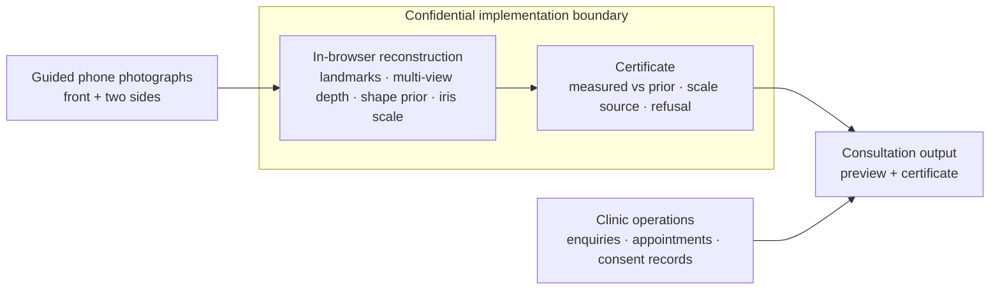
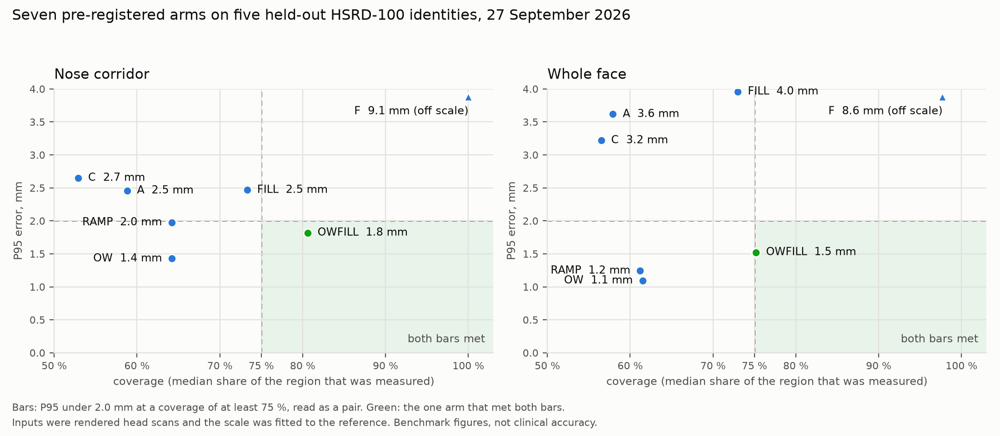

# Case study: AURA, a browser-based facial measurement and surgical-preview platform (private, prototype)

> | | |
> |---|---|
> | Status | Private research prototype, my own project. It has no users, revenue or clinic yet. The source is not public. |
> | Scale | About 2,800 commits (September 2026): the patient-side web application, the clinic workflow, the API, the measurement programme and the operations tooling. |
> | What it does | Turns guided phone photographs into a metric three-dimensional face inside the browser. It is designed to state region by region what was measured and what was assumed, and to refuse when the evidence is insufficient. |
> | Accuracy | On the five held-out identities of the openly licensed HSRD-100 head-scan collection (two more were used for tuning; three were refused and counted as failures), the only one of seven pre-registered arms that met both pre-registered bars reached a nose-region median of 0.29 mm and a 95th percentile of 1.8 mm at 81 % coverage, and a whole-face 95th percentile of 1.5 mm at 75 % coverage (27 September 2026). Inputs were rendered scans, and scale was fitted to the reference. These are benchmark results; no clinical accuracy is claimed. An independent validation on living faces is the next milestone. |
> | Engineering controls | Pre-registered measurements with control arms, worst-case and 95th-percentile reporting, a review rule for every pull request since September 2026 (a heuristic count on 4 October 2026 finds a recorded review on 79 to 93 % of the pull requests opened and merged since 1 September), property-based and mutation testing on the payment paths. |
>
> Scope and confidentiality: this is my own project. Its technical direction, architecture and review
> are my responsibility. The implementation stays private while intellectual-property work is
> ongoing; this case study describes scope, methods, status and dated benchmark results.
>
> | Context | |
> |---|---|
> | Ownership | My own project, held by me |
> | Role | Founder and technical owner: product, frontend, backend, measurement programme and operations |
> | Delivery status | Working prototype in testing; a source-code delivery package with release scripts, runbooks and compliance documentation exists; zero users |
> | Verification available | An architecture walkthrough and selected non-confidential evidence, under confidentiality |
> | Confidential | Source code, internal architecture, algorithms, the mechanisms behind the certificate's decisions, and model/data assets |

> For non-technical readers: a patient photographs their own face with their phone. The browser
> guides them through it. In the patient preview the system builds a three-dimensional model on the
> device and shows the change a physician has planned. Every result is designed to come with a
> certificate that says which parts were measured and which were assumed, and the system is built to
> say no when it cannot measure. The clinic's enquiries, appointments and consent records live around
> that experience, in the same system.

## What the project covers

AURA takes an applied computer-vision problem end to end, as far as a product surface that works and
can be tested. That covers the patient-facing capture and preview, the clinic operations, the
backend, data protection, a measurement programme run like an experiment, release packaging and an
operational handover package. The techniques behind the certificate's decisions are left out of
this public document.

## Public system view

The diagram maps capabilities only. Internal algorithms, control logic and model/data assets remain
confidential.

## Engineering outcomes

### A reconstruction that runs where the patient is

In the patient preview the reconstruction runs in the browser, on the patient's own device. It uses
landmarks from several views together with side-view and silhouette depth, a statistical shape
prior (only when it passes a shape gate), and metric scale from iris statistics or a named
population fallback. In the patient preview, photographs reach the clinic only after the patient's
explicit opt-in. A denser metric pipeline (a self-calibrating sparse bundle adjustment and dense
photometric refinement) is measured in research code beside the product. It is not in the product
yet.

### The certificate

Each capture is designed to receive a certificate. It says which regions were measured from evidence
and which were filled from the prior, how the metric scale was obtained, and how wide the
uncertainty is. Where the evidence is insufficient, the system is designed to refuse to render and
ask for a new capture. The refusal rate is meant to be published beside the accuracy. One known gap
in the prior labelling is filed and will be published with it.

### Measurement run as an experiment

Since September 2026 accuracy measurements are pre-registered before their result is seen. The
metric, the bar, the rival hypothesis and the control arms are written first. The reference surface
must score zero error; an arm with shuffled identities must score chance. Results are reported by
worst case and 95th percentile, never by a median alone, and a missed bar goes into the record like
any other result. So far the pipeline has been measured against photogrammetric ground truth
(rendered head scans) on held-out identities. Real scanner-rig photographs meet no bar yet. The
benchmark figures above come from this programme, and no independent laboratory has confirmed them
yet.

The chart below is drawn from the run record of 27 September 2026. Each arm is one pre-registered
variant of the pipeline. The bars were fixed before the held-out identities were scored, and an arm
meets a bar only as a pair: a 95th percentile under 2.0 mm, at a coverage of at least 75 %.

The arm inside both bars has a nose-region median of 0.29 mm, as the table above says. The chart
plots the 95th percentile, because that is what the bars are set on.

### External statements

Two people outside the project have put something in writing about it. Neither statement is a
validation of AURA, and the page does not present it as one.

- Dr. M. Mazhar Çelikoyar (Otorhinolaryngology, Head and Neck Surgery, Demiroğlu Bilim University
  Faculty of Medicine, Istanbul), whose group has published 3D facial measurement methods for
  rhinoplasty with agreement and reliability studies, wrote a scientific support note on 30 September
  2026. It judges the derivation of 3D facial geometry from ordinary RGB images, validated against
  independent 3D references, a scientifically meaningful and current research direction. The note
  carries no financial, contractual or institutional commitment, and it does not assess AURA or its
  results.
- Prof. Balvinder Khambay (Professor of Orthodontics, School of Dentistry, University of Birmingham;
  3D facial imaging research) replied on 5 October 2026 to a request for an independent validation
  that he thinks he can have one of his students undertake research in this area. Scope, data access
  and terms are not agreed, and no study has started.

### Test discipline across research and money paths

Automated tests run before every sizeable merge. At acceptance checkpoints an end-to-end rehearsal
of the patient flow also runs, on a seeded stack. Payment-amount handling is covered by unit and
property-based tests and by mutation testing. Since September 2026 every merge is meant to have a
recorded review. In practice, a heuristic count on 4 October 2026 found one for 155 to 181 of the
195 pull requests opened and merged since 1 September (79 to 93 %). The range comes from a strict
and a loose rule for what counts as a review record.

### Privacy, operations and handover

Patient-adjacent data handling has documented KVKK controls and commercial-messaging controls.
Consent is captured as evidence. The delivery package includes operational configuration, release
verification, runbooks and contract checks.

## What is not claimed

- No clinical accuracy claim until an independent reference has measured the system on living faces.
- No prediction of a surgical outcome: the preview shows a plan.
- No certification of regions the photographs did not observe.
- Clinical benefit and effects on conversion or revenue have not been measured, and none is claimed.
- It has no users, revenue or clinic yet.

## Not disclosed

- Source code, deployment topology and internal component names
- Proprietary algorithms, the mechanisms behind the certificate's decisions, control logic and model/data preparation
- Formulas, internal sequencing and implementation-specific evidence

*A high-level architecture walkthrough and selected non-confidential evidence can be discussed
privately under an appropriate confidentiality agreement.*

`computer vision` `multi-view geometry` `facial measurement` `pre-registered validation`
`data provenance` `full-stack product delivery` `automated testing` `KVKK`
