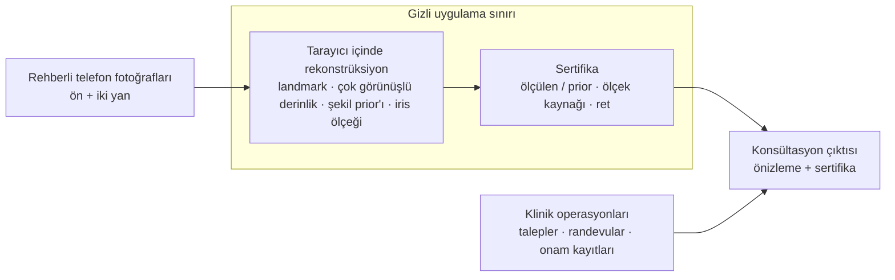

# Vaka çalışması: AURA, tarayıcı tabanlı yüz ölçümü ve cerrahi önizleme platformu (özel, prototip)

> | | |
> |---|---|
> | Durum | Özel bir araştırma prototipi, kendi projem. Henüz kullanıcısı, geliri ya da kliniği yok. Kaynak kod herkese açık değil. |
> | Ölçek | Yaklaşık 2.800 commit (Eylül 2026): hasta tarafındaki web uygulaması, klinik iş akışı, API, ölçüm programı ve operasyon araçları. |
> | Ne yapar | Rehberli telefon fotoğraflarını tarayıcı içinde metrik bir üç boyutlu yüze dönüştürür. Bölge bölge neyin ölçüldüğünü, neyin varsayıldığını söylemek ve kanıt yetersizse reddetmek üzere tasarlandı. |
> | Doğruluk | Açık lisanslı HSRD-100 kafa taraması koleksiyonunun held-out beş kimliğinde (iki kimlik daha ayar için kullanıldı; üç kimlik reddedildi ve başarısız sayıldı), ön kayda alınmış yedi koldan iki çıtayı da karşılayan tek kol burun bölgesinde %81 kapsamla 0,29 mm medyana ve 1,8 mm 95. yüzdeliğe, yüzün tamamında ise %75 kapsamla 1,5 mm 95. yüzdeliğe ulaştı (27 Eylül 2026). Girdiler render edilmiş taramalardı ve ölçek referansa fit edildi. Bunlar karşılaştırma ölçümleri; klinik doğruluk iddiası taşımıyor. Yaşayan yüzlerde bağımsız doğrulama bir sonraki kilometre taşı. |
> | Mühendislik kontrolleri | Kontrol kollu ön kayıtlı ölçümler; en kötü durum ve 95. yüzdelikle raporlama; Eylül 2026'dan bu yana her pull request için inceleme kuralı (4 Ekim 2026'daki sezgisel bir sayımda 1 Eylül'den sonra açılıp birleştirilen PR'ların %79–93'ünde kaydedilmiş inceleme bulundu); ödeme yollarında property-based ve mutation testleri. |
>
> Proje kapsamı ve gizlilik: Bu benim kendi projem. Teknik yön, mimari ve inceleme benim
> sorumluluğumda. Fikrî mülkiyet çalışması sürdüğü için uygulama kapalı tutuluyor; bu vaka çalışması
> kapsamı, yöntemleri, mevcut durumu ve tarihli ölçüm sonuçlarını anlatıyor.
>
> | Bağlam | |
> |---|---|
> | Sahiplik | Kendi projem, bende |
> | Rol | Kurucu ve teknik sahip: ürün, frontend, backend, ölçüm programı ve operasyon |
> | Teslim durumu | Testte çalışan bir prototip; sürüm betikleri, runbook'lar ve uyum belgelerini içeren bir kaynak kod teslim paketi mevcut; sıfır kullanıcı |
> | Sunulabilen doğrulama | Gizlilik koşuluyla mimari anlatım ve seçilmiş, gizli olmayan kanıtlar |
> | Gizli tutulanlar | Kaynak kod, iç mimari, algoritmalar, sertifikanın kararlarının arkasındaki mekanizmalar ve model/veri varlıkları |

> Teknik olmayan okurlar için kısaca: Hasta, tarayıcının yönlendirmesiyle kendi yüzünü telefonuyla
> fotoğraflar. Hasta önizlemesinde sistem üç boyutlu modeli cihazın üzerinde kurar ve hekimin
> planladığı değişikliği gösterir. Her sonuç, hangi bölgelerin ölçüldüğünü, hangilerinin
> varsayıldığını söyleyen bir sertifikayla gelecek şekilde tasarlandı. Sistem ölçemediğinde hayır
> diyecek şekilde kuruldu. Kliniğin talepleri, randevuları ve onam kayıtları da bu deneyimin
> çevresinde, aynı sistemde duruyor.

## Proje neleri kapsıyor?

AURA, uygulamalı bir bilgisayarlı görü problemini baştan sona ele alıp çalışan, test edilebilir
bir ürün yüzeyine kadar taşıyor. Buna hastanın kullandığı çekim ve önizleme, klinik operasyonları,
backend, veri koruma, deney gibi yürütülen bir ölçüm programı, sürüm paketi ve operasyonel devir
paketi dahil. Sertifikanın kararlarını veren yöntemler bu herkese açık belgenin dışında bırakıldı.

## Herkese açık sistem görünümü

Şema yalnızca yetenekleri gösteriyor. İç algoritmalar, kontrol mantığı ve model/veri varlıkları
gizli.

## Mühendislik sonuçları

### Hastanın olduğu yerde çalışan bir rekonstrüksiyon

Hasta önizlemesinde rekonstrüksiyon, hastanın kendi cihazında, tarayıcıda çalışır. Birden çok
görünüşten gelen landmark'larla birlikte yan görünüş ve silüet derinliğini, istatistiksel bir şekil
prior'ını (yalnızca şekil kapısını geçtiğinde) ve iris istatistiğinden ya da adı yazılan bir nüfus
tabanlı yedekten gelen metrik ölçeği kullanır. Hasta önizlemesinde fotoğraflar kliniğe yalnızca
hastanın açık onayından sonra ulaşır. Daha yoğun bir metrik hat (kendini kalibre eden seyrek bundle
adjustment ve yoğun fotometrik iyileştirme) ürünün yanında, araştırma kodunda ölçülüyor. Henüz
üründe yok.

### Sertifika

Her çekim bir sertifika alacak şekilde tasarlandı. Sertifika hangi bölgelerin kanıttan ölçüldüğünü,
hangilerinin prior'dan doldurulduğunu, metrik ölçeğin nasıl elde edildiğini ve belirsizliğin ne
kadar geniş olduğunu söylüyor. Kanıt yetersizse sistem göstermeyi reddedip yeni bir çekim isteyecek
şekilde tasarlandı. Ret oranının doğrulukla birlikte yayımlanması amaçlanıyor. Prior
etiketlemesindeki bilinen bir boşluk kayıtlı ve onunla birlikte yayımlanacak.

### Deney gibi yürütülen ölçüm

Eylül 2026'dan bu yana doğruluk ölçümleri, sonucu görülmeden önce ön kayda alınıyor. Ölçüt, çıta,
rakip hipotez ve kontrol kolları önce yazılır. Referans yüzey sıfır hata vermeli. Kimlikleri
karıştırılmış kol ise şans düzeyi vermeli. Sonuçlar en kötü durum ve 95. yüzdelikle bildirilir,
medyan hiçbir zaman tek başına verilmez; tutmayan bir çıta da her sonuç gibi kayda geçer. Hat
bugüne kadar held-out kimliklerde fotogrametrik referansa (taranmış kafaların render'ları) karşı
ölçüldü. Ama gerçek tarama düzeneği fotoğraflarında henüz hiçbir çıta tutmadı. Yukarıdaki
karşılaştırma değerleri bu programdan geliyor ve bağımsız bir laboratuvar onları henüz doğrulamadı.

Aşağıdaki grafik 27 Eylül 2026 tarihli koşu kaydından çizildi. Her kol, hattın ön kayda alınmış bir
varyantı. Çıtalar held-out kimlikler puanlanmadan önce sabitlendi ve bir kol çıtayı ancak çift olarak
karşılar: en az %75 kapsamda 2,0 mm'nin altında bir 95. yüzdelik.

İki çıtanın da içindeki kolun burun bölgesi medyanı, yukarıdaki tabloda yazdığı gibi 0,29 mm.
Grafik ise 95. yüzdeliği gösteriyor, çünkü çıtalar onun üzerinden konmuş.

### Dış beyanlar

Proje dışından iki kişi bu çalışma hakkında yazılı bir şey söyledi. İkisi de AURA'nın doğrulanması değil
ve bu sayfa onları öyle sunmuyor.

- Demiroğlu Bilim Üniversitesi Tıp Fakültesi'nden Dr. M. Mazhar Çelikoyar (Kulak Burun Boğaz, Baş ve
  Boyun Cerrahisi), 30 Eylül 2026 tarihli bilimsel destek notunda, sıradan RGB görüntülerden 3B yüz
  geometrisi elde edilmesini ve bunun bağımsız 3B referanslarla doğrulanmasını bilimsel olarak anlamlı ve
  güncel bir araştırma yönü olarak değerlendiriyor. Grubunun rinoplasti için 3B yüz ölçüm yöntemleri,
  uyum ve güvenilirlik çalışmaları yayımlanmış durumda. Not hiçbir mali, sözleşmesel veya kurumsal
  taahhüt içermiyor; AURA'yı ve sonuçlarını değerlendirmiyor.
- Birmingham Üniversitesi Diş Hekimliği Fakültesi'nden Prof. Balvinder Khambay (Ortodonti Profesörü; 3B
  yüz görüntüleme araştırmaları), 5 Ekim 2026'da bağımsız doğrulama talebine, bu alanda bir öğrencisine
  araştırma yaptırabileceğini düşündüğü yanıtını verdi. Kapsam, veri erişimi ve koşullar belirlenmedi;
  başlamış bir çalışma yok.

### Araştırma ve para yollarında test disiplini

Otomatik testler her büyük birleştirmeden önce koşar. Kabul noktalarında ayrıca hasta akışının uçtan
uca bir provası, seed'li bir ortamda yürütülür. Ödeme tutarlarını işleyen kod, birim ve
property-based testlerin yanında mutation testleriyle de sınanıyor. Eylül 2026'dan bu yana her
birleştirmenin kayıtlı bir incelemesi olması hedefleniyor. Uygulamada, 4 Ekim 2026'daki sezgisel
bir sayım 1 Eylül'den sonra açılıp birleştirilen 195 PR'ın 155 ile 181'i arasında inceleme kaydı
buldu (%79–93). Aralık, neyin inceleme kaydı sayılacağına dair katı ve gevşek iki kuraldan geliyor.

### Gizlilik, operasyon ve devir

Hastaya yakın veri işlemede belgelenmiş KVKK kontrolleri ve ticari ileti kontrolleri var. Onam,
kanıt olarak kaydediliyor. Teslim paketi operasyonel yapılandırmayı, sürüm doğrulamasını,
runbook'ları ve sözleşme kontrollerini içeriyor.

## İddia edilmeyenler

- Bağımsız bir referans sistemi yaşayan yüzlerde ölçene kadar klinik doğruluk iddiası yok.
- Cerrahi sonuç tahmini yok: önizleme bir planı gösterir.
- Fotoğrafların gözlemlemediği bölgeler için sertifika yok.
- Klinik fayda, dönüşüm ve gelir etkisi ölçülmedi; hiçbiri iddia edilmiyor.
- Henüz kullanıcısı, geliri ya da kliniği yok.

## Açıklanmayanlar

- Kaynak kod, dağıtım topolojisi ve iç bileşen adları
- Özel algoritmalar, sertifikanın kararlarının arkasındaki mekanizmalar, kontrol mantığı ve model/veri hazırlığı
- Formüller, iç sıralama ve uygulamaya özgü kanıtlar

*Üst düzey bir mimari anlatım ve seçilmiş, gizli olmayan kanıtlar uygun bir gizlilik sözleşmesi
altında özel olarak görüşülebilir.*

`bilgisayarlı görü` `çok görünüşlü geometri` `yüz ölçümü` `ön kayıtlı doğrulama` `veri kökeni`
`full-stack ürün teslimi` `otomatik test` `KVKK`
